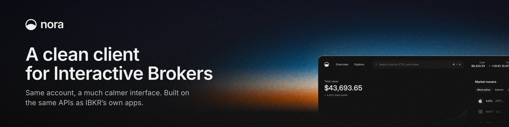

[](https://deploy.workers.cloudflare.com/?url=https://github.com/1danii/nora)

The button deploys your own private nora on your Cloudflare account. One step remains after it: [turn on Cloudflare Access](#2-turn-on-cloudflare-access). Prefer an AI agent to do it all? [Copy the prompt below](#deploy-with-an-agent).

## What it is

nora is an alternative front end for your existing IBKR account. It talks to the same endpoints IBKR Mobile, GlobalTrader and the Client Portal use, so the numbers match what IBKR shows you.

- **Account**: balance, buying power, available funds, excess liquidity and cash by currency
- **Holdings**: positions and performance
- **Assets**: price charts, after-hours prices, analyst ratings and price targets, company info, news
- **Explore**: market movers and search across listings
- **Demo**: a sample account to try without logging in

Trading isn't in nora yet. It's an early work in progress.

### How your account stays yours

- **Your deployment, your account.** Each person runs their own copy on their own Cloudflare account. Only the one IBKR username you set can log in.
- **Locked behind Cloudflare Access.** A private deployment answers every request with 403 until Cloudflare Access protects it, so only you can open it.
- **Nothing stored.** You log in with your IBKR username, password and 2FA, the same as IBKR's own apps. The session lives in an encrypted cookie in your browser, the password is never saved, and IBKR data is fetched live. There is no database.

nora isn't affiliated with or endorsed by Interactive Brokers.

## Deploy with an agent

Paste this into a coding agent that can run commands on your machine (Claude Code, Codex, Cursor and similar). It asks you for what it needs, deploys your private nora, checks that Access protects it and, if you choose a fork, sets up automatic deploys from your GitHub.

```text
Deploy a private copy of nora (https://github.com/1danii/nora), a web client for Interactive Brokers, to my Cloudflare account as a Cloudflare Worker. Work through the steps in order; each ends on a check, and a step is done only when its check passes. Show me the command output that proves each check.

Secrets: generate SESSION_SECRET yourself and pipe it straight into Wrangler, so it never appears in the chat, in a file or in git. My IBKR password and 2FA are typed only into the deployed site, so this setup needs only my IBKR username.

1. Ask me, in one message:
   - my IBKR username (the one I log in to IBKR with; only it will be able to log in)
   - a name for the Worker (default: nora). It becomes the address https://<name>.<my-subdomain>.workers.dev
   - how to keep the code. Fork (recommended when the GitHub CLI `gh` is installed and logged in): a fork on my GitHub that Cloudflare redeploys on every push, so updating is GitHub's "Sync fork" button. Local: a plain clone on this machine that I redeploy myself.
   Check: you have all three answers. Call the Worker name NAME below.

2. Get the code. Make sure git and bun are installed (install bun from https://bun.sh if missing, after asking me). Fork: `gh repo fork 1danii/nora --clone`. Local: `git clone https://github.com/1danii/nora`. Run `bun install` in the new folder, and every later command from there.
   Check: `bun install` finished without errors.

3. Log in to Cloudflare. Run `bunx wrangler login` and tell me to approve it in the browser window it opens. Then run `bunx wrangler whoami`. If it lists more than one account, ask me which one to use and set CLOUDFLARE_ACCOUNT_ID to its ID for every later command.
   Check: `bunx wrangler whoami` shows me logged in, with one account chosen.

4. Build and deploy: `bun run build && bun run deploy -- --name NAME`. The config already sets IBKR_LOGIN_MODE=private; keep it.
   Check: the deploy output prints the Worker's workers.dev URL. Call it URL below.

5. Set the two secrets on the Worker:
   - `openssl rand -base64 48 | tr -d '\n' | bunx wrangler secret put SESSION_SECRET --name NAME`
   - `printf '%s' '<my IBKR username>' | bunx wrangler secret put IBKR_ALLOWED_USERNAME --name NAME`
   Check: `bunx wrangler secret list --name NAME` lists both SESSION_SECRET and IBKR_ALLOWED_USERNAME.

6. Confirm the Worker is locked. Run `curl -s -o /dev/null -w '%{http_code}\n' URL`.
   Check: it prints 403. That is the Worker refusing traffic that hasn't come through Cloudflare Access, which is correct at this point.

7. Turn on Cloudflare Access. This step is in the dashboard, so walk me through it and wait for me to say it's done:
   - Open https://dash.cloudflare.com, go to Workers & Pages, and open the NAME Worker.
   - Settings → Domains & Routes → Cloudflare Access: enable it and choose to protect All traffic (not only preview URLs).
   - Make sure the Access policy allows my email address, so I can get in.
   Check: `curl -s -o /dev/null -w '%{http_code} %{redirect_url}\n' URL` prints a 302 redirect to a *.cloudflareaccess.com address. If it still prints 403, Access isn't covering all traffic yet: help me fix it and run the check again.

8. Fork only: connect the fork to Workers Builds. Walk me through it in the dashboard and wait for me:
   - In the NAME Worker: Settings → Builds → Connect, choose GitHub, install or authorize the Cloudflare app if asked, and pick my fork with branch main.
   - Build command: `bun run build`. Deploy command: `bun run deploy -- --name NAME` (replacing the default `npx wrangler deploy`, which would ship the source config instead of the build). Leave the root directory empty.
   Then trigger a build: `git commit --allow-empty -m "Trigger first Workers Build" && git push`.
   Check: I confirm the build for that commit succeeded in the Worker's Deployments, and afterwards `bunx wrangler secret list --name NAME` still lists both secrets and the curl from step 7 still prints the 302 to *.cloudflareaccess.com.

9. Tell me:
   - URL, and that I open it, pass the Cloudflare Access login with my email, then log in with my IBKR username, password and 2FA
   - how to update. Fork: press "Sync fork" on my fork's GitHub page, and Cloudflare redeploys. Local: from this folder, `git pull && bun install && bun run build && bun run deploy -- --name NAME`
```

## Deploy by hand

### 1. Deploy the Worker

**With the button.** Click [Deploy to Cloudflare](https://deploy.workers.cloudflare.com/?url=https://github.com/1danii/nora). It copies the repo to your GitHub, sets up Workers Builds and asks for two values:

- `IBKR_ALLOWED_USERNAME`: your IBKR username. Only this account can log in.
- `SESSION_SECRET`: a random string of at least 32 characters, for example from `openssl rand -base64 48`.

Keep `IBKR_LOGIN_MODE` set to `private`. If you change the Workers Builds settings later, the deploy command must stay `bun run deploy`: the default `npx wrangler deploy` reads the source config instead of the built one.

**From your machine.** With [Bun](https://bun.sh) installed:

```bash
git clone https://github.com/1danii/nora && cd nora
bun install
bunx wrangler login
bun run build && bun run deploy
openssl rand -base64 48 | tr -d '\n' | bunx wrangler secret put SESSION_SECRET
bunx wrangler secret put IBKR_ALLOWED_USERNAME   # type your IBKR username
```

This deploys a Worker named `nora`. Add `-- --name <name>` to `bun run deploy`, and `--name <name>` to each `wrangler secret put`, to pick another name.

### 2. Turn on Cloudflare Access

Until you do, every page answers 403.

1. In the [Cloudflare dashboard](https://dash.cloudflare.com), open **Workers & Pages** and then your Worker.
2. Go to **Settings → Domains & Routes → Cloudflare Access**, enable it and protect **All traffic** (not only previews).
3. Make sure the Access policy lets your email in.

Open the Worker's URL: Cloudflare asks for your email first, then nora shows its IBKR login.

The Worker checks every request for a valid Cloudflare Access token, so it needs no Access settings of its own. That check catches a deployment left without Access; Access itself is what keeps others out.

### Update

Deployments connected to GitHub redeploy on every push to your copy. A fork updates with **Sync fork** on GitHub. The button's copy isn't a fork, so pull this repo into it with git (`git pull https://github.com/1danii/nora main`, then push). Without GitHub, from your machine, run `git pull && bun install && bun run build && bun run deploy`.

### Public demo

A public deployment that only offers the demo account, with no Access or secrets needed:

```bash
bun run build && bun run deploy -- --name nora-demo --var IBKR_LOGIN_MODE:demo
```

## Development

Local setup, architecture and scripts: [DEVELOPMENT.md](DEVELOPMENT.md).
